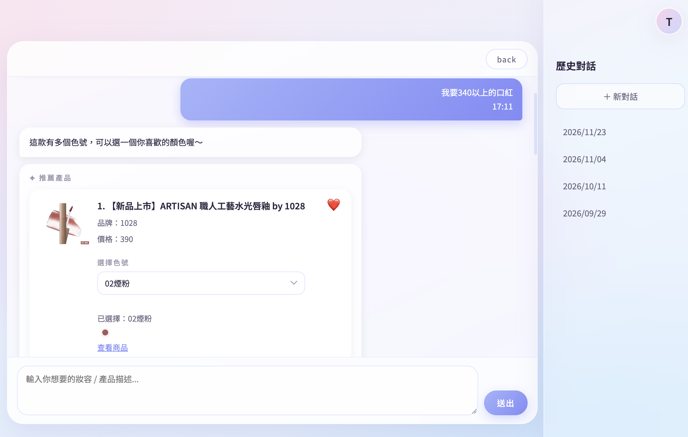
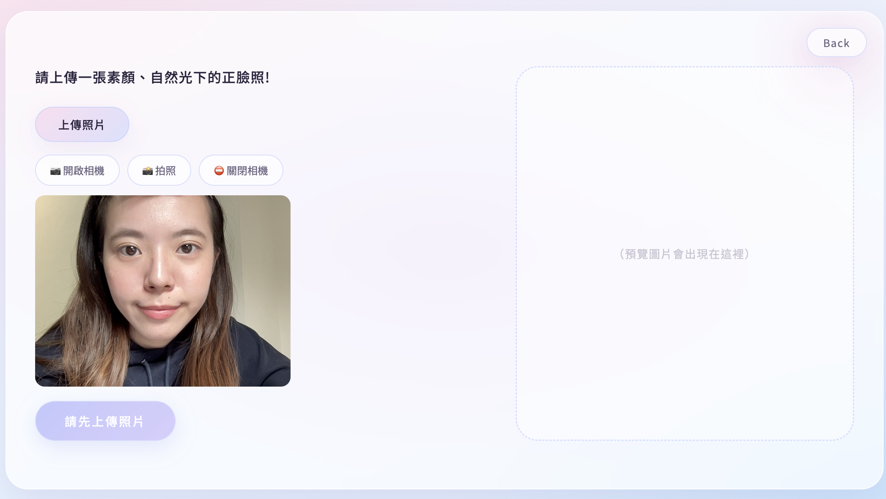
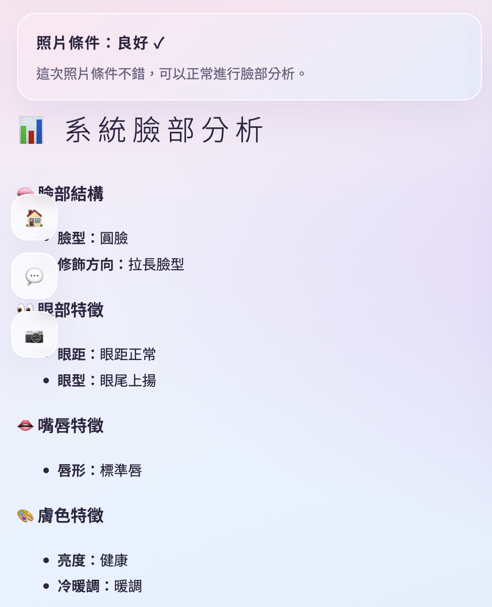
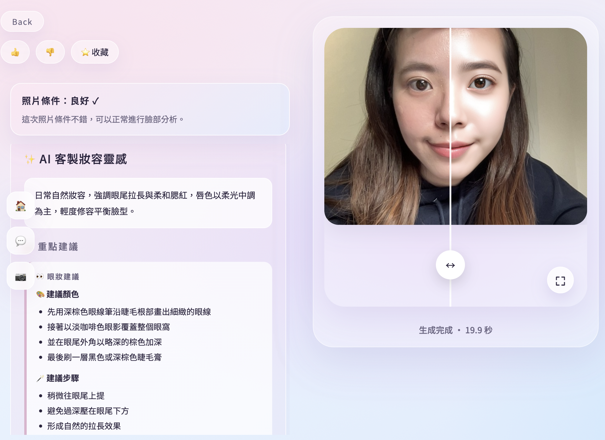

# makeup-recommendation-showcase

## Project Overview
This project is an AI-generated makeup recommendation website developed as a three-member undergraduate capstone project.

The system provides personalized makeup recommendations through conversations, facial analysis, and AI-generated makeup previews.

## System Features

### 1. Chat Recommendation
Users can receive products and makeup recommendations through an interactive chat interface.

### 2. Facial Analysis
The system analyzes uploaded facial images and provides personalized makeup suggestions.

### 3. Makeup Preview
Users can preview AI-generated makeup results based on their facial images.

### 4. Favorites
Users can save their preferred makeup looks and products.

## Technologies Used

- Frontend: HTML, CSS, JavaScript
- Backend: Python, Flask
- Database: MongoDB
- AI Tools: Ollama, ComfyUI

## My Contributions

- Participated in system setup and execution.
- Conducted functional testing of the website.
- Developed a conversational makeup recommendation module.
- Created a makeup visualization module using ComfyUI.
- Troubleshot execution errors with AI-assisted tools.
- Participated in evaluating AI-generated results under different facial angles.

AI-assisted code generation was used during development.

## Project Screenshots

### Chat Recommendation

### Facial Analysis

### AI Makeup Preview

